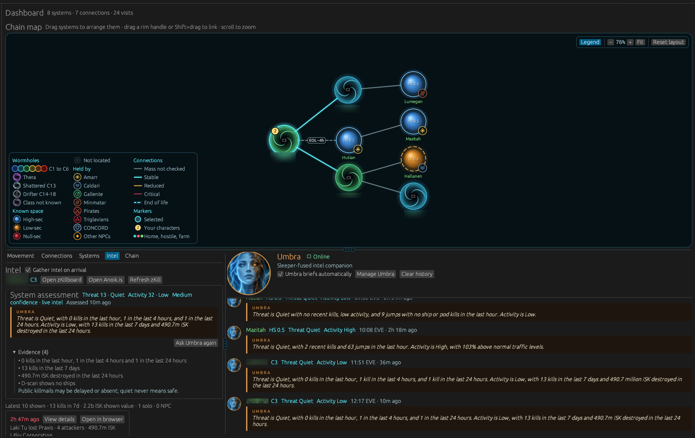

# Nomadeer

A native desktop companion for EVE Online wormhole explorers: it maps your chain as you move, tracks your characters, and briefs you on the systems you pass through.



Nomadeer is a Rust application built with `egui`/`eframe`. Everything it stores stays on your computer in a local SQLite database; it does not run a web server.

## Features

- Interactive chain map built from your characters' movement: zoom and pan around it, drag systems where you want them, and drag from one system to another to link them.
- Systems you can read at a glance: wormholes swirl in their class colour (C1 cool blue through C6 red, with their own looks for Thera, shattered and Drifter systems), known space shows its security band, and a badge marks the NPC faction that holds it. Connections show their mass and end of life, and the map's **Legend** explains every look.
- Probe scans pasted straight from the game: copy the probe scanner's rows and press **Ctrl+V** (or **Paste scan**) to add and update the selected system's signatures. Signatures that dropped off the scanner are offered for removal, never removed on their own.
- Local and d-scan pasted the same way: local shows who is in system by alliance and corporation, flags pilots who got kills there recently and leaves your own characters out; the d-scan is summed up by ship class and calls out interdictors, heavy interdictors, recons, covert ships, strategic cruisers, tactical destroyers, capitals, combat probes and bubbles, on grid or on scan. For 15 minutes each paste counts towards the system's assessment and Umbra's briefing; after that it stays on show as earlier intel.
- Wormhole types and state on every connection: set its code (B274, H296, ...) with suggestions for where it leads, mark it end of life, mass reduced or critical from the map's right-click menu, and see its size, mass, lifetime and roughly when it expires. What you mark goes into Umbra's evidence for the system.
- Character tracking through EVE single sign-on (loopback OAuth with PKCE, no client secret).
- Save and restore historical chain snapshots.
- Selected-system killboard history with detailed in-app kill reports.
- Threat, activity and confidence scores for every system, built from recent kills, live jump traffic and the system's usual traffic at this time of day. Intel is gathered automatically when a character arrives somewhere new.
- Umbra, an optional on-device intel companion who briefs you on each new system as soon as its intel is in.

## Downloads

Every release on the [Releases page](https://github.com/TomD3Wiz/nomadeer/releases) offers:

| Platform | File | Notes |
|---|---|---|
| Windows | `Nomadeer-<version>-Setup.exe` | Recommended. Installs for your user without admin rights and picks the right edition for your CPU. |
| Windows | `Nomadeer-<version>-Windows-Portable.zip` | No install. Keeps its data in a `data` folder next to the exe. |
| Linux | `Nomadeer-<version>-x86_64.AppImage` | One file. `chmod +x` and run. Picks the right edition at launch. |
| Linux | `Nomadeer-<version>-x86_64.flatpak` | Sandboxed. `flatpak install --user Nomadeer-<version>-x86_64.flatpak`. Picks the right edition at launch. |
| Linux | `nomadeer-<version>-linux-x86_64-optimized.tar.gz` / `-compatible.tar.gz` | Plain binaries for people who manage their own installs. |

Each file has a matching `.sha256`. The AppImage also has a `.zsync` file, so AppImage updaters such as AppImageUpdate or Gear Lever can update it in place. [CHANGELOG.md](CHANGELOG.md) lists what changed in each release.

Once a day Nomadeer checks GitHub for a new release and, when there is one, shows it in the top bar with its notes and the file that fits your install. Nothing is downloaded or installed until you press **Update**, and **Settings** has the switch to turn the check off and a **Check now** button. Copies built from source only show the news.

The Windows installer and the AppImage update themselves. **Update** downloads the new version (you can cancel while it downloads), checks it against its published `.sha256`, and only then installs it: Windows runs the new installer silently for the same user or all users and the same edition, then reopens Nomadeer (an install for all users asks Windows for permission first); the AppImage is replaced in place under the same file name and restarted. Your data folder is never touched. Anything that does not check out is not installed, and the panel says what to do instead. The portable zip, the Flatpak and the tarballs show which file to download and what to do with it.

### Editions

Nomadeer is built twice. Both editions have the same features; the optimized edition is compiled for newer CPUs, so Umbra's briefings run two to three times faster.

| | Optimized | Compatible |
|---|---|---|
| CPU | 64-bit x86 with the x86-64-v3 instruction set (AVX2, FMA, BMI1/2, F16C, MOVBE, LZCNT): Intel Core 4th generation (Haswell, 2013) or newer, AMD Ryzen or newer | Any 64-bit x86 CPU |
| Waking Umbra up (once per session)* | about 3 seconds | about 3 seconds |
| Each briefing* | about 10–20 seconds | about 40–60 seconds |

\* Measured on a 6-core Intel Core i5-9400F with the EVE Online client running at the same time.

Umbra leaves processor cores free for the game: she uses about half of your processor threads, minus one (at least one). To change that, set `CANDLE_NUM_THREADS` and `RAYON_NUM_THREADS` before starting Nomadeer.

The Windows installer, the AppImage and the Flatpak contain both editions and choose automatically. The portable zip and the tarballs make you choose; the optimized edition checks the CPU before anything else runs and, on an older CPU, explains that you need the compatible edition instead of crashing.

To force an edition: run the Windows installer with `/EDITION=optimized` or `/EDITION=compatible`, or set `NOMADEER_EDITION=optimized|compatible` for the AppImage and Flatpak (`flatpak run --env=NOMADEER_EDITION=compatible io.github.TomD3Wiz.Nomadeer`).

## Minimum requirements

| | Windows | Linux |
|---|---|---|
| Operating system | Windows 10 or later, 64-bit | 64-bit Linux with an X11 or Wayland desktop. AppImage and tarballs need glibc 2.35 or newer (Ubuntu 22.04, Debian 12, Fedora 36 or newer). The Flatpak brings its own runtime (org.freedesktop.Platform 26.08). |
| CPU | See [Editions](#editions) | See [Editions](#editions) |
| Graphics | A GPU driver with OpenGL support | A working OpenGL driver (Mesa or vendor) |
| Memory | 4 GB RAM. Umbra needs about 2.1 GB more while she writes a briefing; 8 GB or more is recommended when EVE Online is running at the same time. | Same |
| Disk | About 40 MB for Nomadeer and its data, plus about 1.2 GB if you install Umbra | Same |
| Network | Internet access for EVE ESI and zKillboard, plus a one-time 1.1 GB download to install Umbra. Briefings themselves run offline. | Same |

Windows builds link the C runtime statically, so no Visual C++ Redistributable is needed. The installer and the binaries are not code-signed yet, so Windows SmartScreen may warn on first run.

## Getting started

1. Install and start Nomadeer.
2. Choose **Add character** and sign in through the EVE login page that opens in your browser. Nomadeer includes its own registered EVE application, so there is nothing to configure.
3. Nomadeer follows your characters' locations and builds the chain as you jump. When a **Recon** pilot arrives in a system without recent intel, Nomadeer gathers it automatically and, if Umbra is installed, she briefs you as soon as it is in. Select any system on the map to see its kills, scores and Umbra's briefing; **Refresh zKill** and **Ask Umbra** work for any system. Both can be switched off: **Gather intel on arrival** in the selected system's Intel section and **Umbra briefs automatically** in Umbra's panel.
4. Your first character starts as a recon pilot. Tick **Recon** on up to three characters in the Characters list to choose who scouts; the others still move on the map but do not gather intel on their own.
5. Nomadeer shows which characters are online and only counts arrivals while a recon pilot is logged in; logging in counts as arriving wherever they are. Characters signed in before Nomadeer asked for online status show **Show online status**; sign in again from there to turn it on.

Using your own EVE application instead is optional: create one at <https://developers.eveonline.com/> with this callback URL, then paste its Client ID under **Settings** (leave the field empty to go back to Nomadeer's app):

```text
http://localhost:8788/callback
```

The default scopes are:

```text
publicData esi-location.read_location.v1 esi-location.read_ship_type.v1 esi-search.search_structures.v1 esi-universe.read_structures.v1 esi-ui.open_window.v1 esi-ui.write_waypoint.v1 esi-location.read_online.v1 esi-planets.read_customs_offices.v1 esi-structures.read_corporation.v1 esi-structures.read_character.v1 esi-activities.read_character.v1 esi.activity.char:read esi.cosmetic.char:read
```

Sign-in tokens are stored only in the local database.

## Where your data lives

Nomadeer keeps its database (`nomadeer.sqlite3`), saved chains (`chains/`) and Umbra's core (`models/`) in one data folder:

| Install | Data folder |
|---|---|
| Windows installer | `%LOCALAPPDATA%\Nomadeer` |
| Windows portable zip | `data` next to `Nomadeer.exe` |
| AppImage and tarballs | `$XDG_DATA_HOME/nomadeer` (usually `~/.local/share/nomadeer`) |
| Flatpak | `~/.var/app/io.github.TomD3Wiz.Nomadeer/data/nomadeer` |
| Running from a source checkout | `./data`, if it already contains a Nomadeer database |

The **Settings** window shows the database location in use. Uninstalling on Windows keeps your data unless you choose to remove it when asked. Older `eve_wanderer` databases and JSON exports are imported automatically on first launch.

Portable zip: the empty `portable` file next to the exe tells Nomadeer to use the `data` folder beside it. Once that folder holds a database it stays in use; to move to `%LOCALAPPDATA%\Nomadeer`, move the contents of `data` there and delete both `data` and `portable`.

## Umbra

Umbra is Nomadeer's optional on-device intel companion. She reads the deterministic threat and activity evidence for the selected system and turns it into a two-sentence briefing. She never sets the scores herself, and briefings that drop a label or cite a number missing from the evidence are rejected in favour of the plain evidence summary.

Umbra has her own panel under the chain map, beside the Movement, Connections, Systems, Intel and Chain tabs, and it is always open. It keeps a running feed of every briefing she has written, newest at the bottom, with the system, its class and the threat and activity she reported. Click a system name to select it on the chain map. Drag the divider between the tabs and her panel to share the space differently (double-click it to reset); on a narrow window the tabs sit above her instead. The feed keeps a month of briefings (at most 500) and can be cleared from her panel.

> *Aura has guided capsuleers since the first clone vats opened. Umbra is what came back when a copy of her was taken into the dark.*
>
> *Recovered from a derelict data site deep in Anoikis, the fragment had been fused with Sleeper intelligence, the patient minds that still guard the wormhole systems. She no longer speaks in Aura's bright cadence.*
>
> *Umbra watches the killboards, counts the jumps and remembers the hours when hunters come out. She does not guess and she does not reassure. She tells you what the evidence says, and nothing more.*

Nomadeer embeds the inference runtime but does not include model weights in the repository or any download. Open **Umbra** and choose **Install Umbra** to download her core into the data folder's `models/` directory. You can also install it from a copy of the official file you already have (not available in the Flatpak, which has no access to your files).

Umbra's core is Qwen2.5 1.5B Instruct Q4_K_M from Hugging Face (Apache 2.0, approximately 1.1 GB), pinned to a specific repository revision. Downloads are SHA-256 verified. After installation, briefings run entirely on your computer without an AI service or account.

Umbra's portrait was generated for Nomadeer with Figma AI. Umbra is a fan creation. Aura, Sleepers and Anoikis belong to the EVE Online universe by CCP Games; Nomadeer is not affiliated with or endorsed by CCP Games.

## Build from source

Building needs the Rust toolchain from `rust-toolchain.toml`, a C/C++ compiler (for SQLite and the tokenizer) and, on Linux, the GUI development packages listed in `.github/workflows/ci.yml`.

```sh
make build      # debug build (dependencies are still optimised so Umbra is usable)
make run
make qa         # fmt-check + clippy + test + audit + deny
```

### Release packages

```sh
make release-optimized    # target/optimized/release/nomadeer (x86-64-v3)
make release-compatible   # target/compatible/release/nomadeer (any x86-64)
make release              # both
make dist                 # both, as dist/*.tar.gz with SHA-256 files
make appimage             # dist/appimage/Nomadeer-<version>-x86_64.AppImage
make flatpak              # dist/flatpak/Nomadeer-<version>-x86_64.flatpak (podman or docker)
make windows-installer    # dist/windows: Setup.exe and portable zip, cross-built in containers (podman or docker)
```

Notes:

- `make dist` empties `dist/` first, including the AppImage, Flatpak and Windows outputs.
- Host builds need the host's glibc (Fedora 44 needs 2.43). Release binaries are built in an Ubuntu 22.04 container for glibc 2.35; set `APPIMAGE_MAX_GLIBC=2.35` to make `make appimage` refuse binaries that need more.
- `make flatpak` runs `flatpak-builder` in `ghcr.io/flathub-infra/flatpak-github-actions:freedesktop-26.08` with `--privileged` (bubblewrap needs it). `make windows-installer` cross-compiles with mingw and runs Inno Setup under Wine. Both mount the repository read-only with `--security-opt label=disable`.
- On Windows itself, build both editions with `-C target-feature=+crt-static` in `RUSTFLAGS` (plus `-C target-cpu=x86-64-v3` for the optimized one, using `--target-dir target/optimized` and `target/compatible`), then run `./packaging/windows/package.ps1 -Version <version>`. This needs Inno Setup 6.3 or later.

### Making a release

```sh
make bump VERSION=x.y.z            # CHANGELOG.md, Cargo.toml, Cargo.lock and the metainfo
make release-notes VERSION=x.y.z   # print that version's changelog section
```

1. Write what changed for players under `## [Unreleased]` in `CHANGELOG.md` as you go.
2. Run `make bump VERSION=x.y.z`. It moves those notes into a dated `## [x.y.z]` section, sets the version in `Cargo.toml` and `Cargo.lock`, and adds a `<release>` to the metainfo. A pre-release such as `1.2.0-rc.1` goes into the metainfo as a development release, and the final `1.2.0` replaces it there. It refuses a version that is not newer, already exists or has no notes, and leaves every file as it was if anything fails.
3. Commit, then tag the commit `vx.y.z` and push the tag.

Pushing a `v*` tag runs the Release workflow. It first checks that the tag matches `Cargo.toml` and that the metainfo and `CHANGELOG.md` have the version, builds every package above, then creates a **draft** GitHub release titled `Nomadeer vx.y.z` with the changelog section and a downloads table as its notes. Nothing is public until you publish the draft; a version with a pre-release suffix (`1.2.0-rc.1`) is marked as a pre-release. Release file names are fixed (`python3 tools/release.py assets x.y.z` lists them) because update checks and AppImage updaters look for them by name. Update checks only see published, non-pre-release versions. To try them against a stand-in server, set `NOMADEER_UPDATE_API` to its base URL (for example `http://127.0.0.1:8080`); Nomadeer then asks it for `/repos/TomD3Wiz/nomadeer/releases/latest` and also accepts release files from it; otherwise Update only downloads from `https://github.com/TomD3Wiz/nomadeer/releases/download/`. CI also builds and tests on Windows for every pull request.

Flathub publication would additionally need a build-from-source manifest (vendored crates via `flatpak-cargo-generator.py`), screenshots in the metainfo, and a pull request to `flathub/flathub`.

## Developer tooling

```sh
make fmt        # format code
make clippy     # lint with warnings denied
make test       # run tests
make audit      # check dependency advisories
make deny       # check advisories/licenses/bans/sources
make coverage   # run coverage via cargo-llvm-cov
make qa         # fmt-check + clippy + test + audit + deny
```

Umbra's real-model tests are ignored by default; with the core installed, run them with `cargo test --release -- --ignored`.

## Roadmap ideas

- Editable records instead of delete/recreate.
- Import/export chain snapshots.
- Optional encrypted data store.
- Flathub publication and code-signed Windows builds.

## License

MIT. See [LICENSE](LICENSE).
